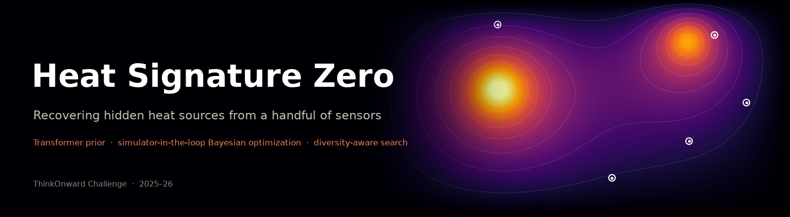
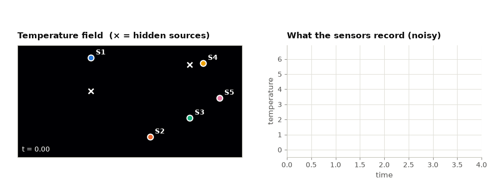
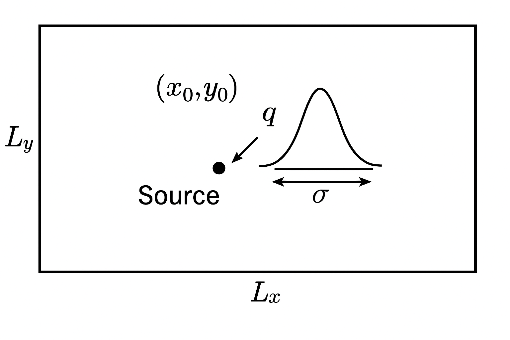
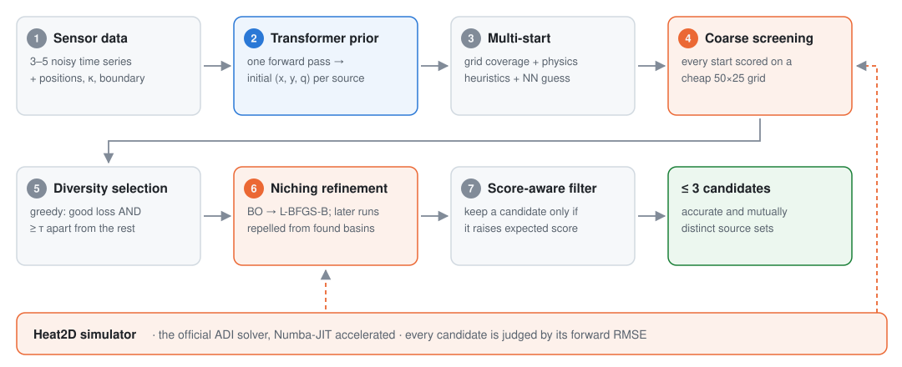
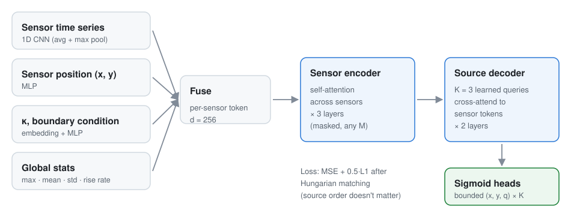
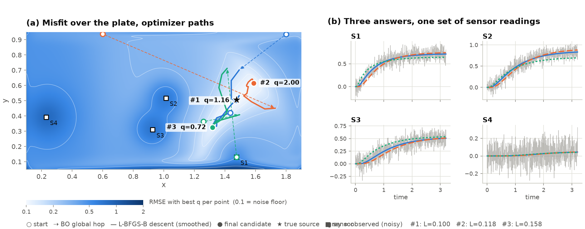
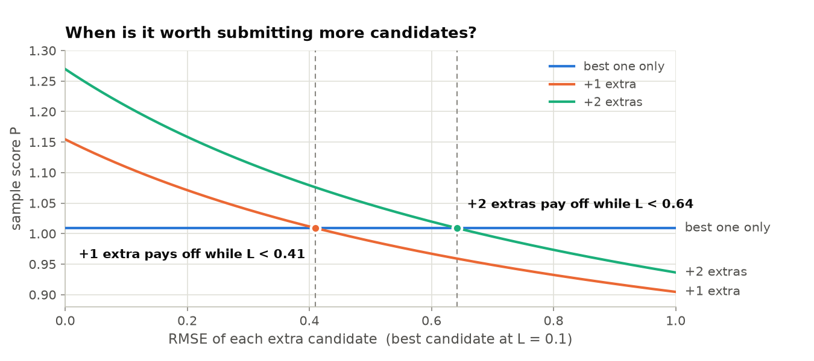

<p align="center">
  
</p>

<p align="center">
  <a href="https://thinkonward.com/app/c/challenges/heat-signature-zero"></a>
  
  
  
  
  
  <a href="LICENSE"></a>
</p>

<p align="center">
  <a href="#-the-problem">Problem</a> ·
  <a href="#-approach">Approach</a> ·
  <a href="#-stage-1-transformer-prior">Transformer</a> ·
  <a href="#-stage-2-simulator-in-the-loop-refinement">Refinement</a> ·
  <a href="#%EF%B8%8F-why-diversity-aware">Scoring</a> ·
  <a href="#-quickstart">Quickstart</a>
</p>

My solution to ThinkOnward's [**Heat Signature Zero**](https://thinkonward.com/app/c/challenges/heat-signature-zero) challenge (Dec 2025 – Feb 2026). The task is to recover the hidden heat sources on a 2D plate from a few noisy temperature sensors.

The approach is a **hybrid**. A cross-attention Transformer gives a fast first guess. An optimizer then refines it, using the challenge's physics simulator as a black box. The optimizer is diversity-aware, because the challenge scores both the accuracy and the diversity of the candidate solutions.

<table align="center">
<tr>
<td align="center"><b>🏆 Public leaderboard</b><br><sub>rank</sub><br><b><code>#13</code></b> of 229 teams</td>
<td align="center"><b>📈 Score</b><br><sub>max possible 1.3</sub><br><b><code>1.1654</code></b></td>
<td align="center"><b>⏱️ Budget</b><br><sub>full test set</sub><br><b>&lt; 1 hour</b></td>
</tr>
</table>

> [!TIP]
> **In one sentence:** the network says *roughly where* the sources are, and the simulator decides *exactly where*. A diversity-aware search returns up to three different answers that each explain the sensor data.

---

## 🔥 The problem

<picture>
  <source media="(prefers-color-scheme: dark)" srcset="assets/problem-dark.gif">
  
</picture>

Heat diffuses over a 2 × 1 plate according to

$$\frac{\partial T}{\partial t} = \kappa \nabla^2 T + \sum_k q_k\, G_\sigma(x - x_k,\; y - y_k)$$

<table>
<tr>
<td width="58%">

The plate has Dirichlet or Neumann boundaries and κ ∈ {0.05, 0.1}. Each sample gives:

- the temperature time series `Y_noisy` (T × M) at M = 3–5 sensors,
- the sensor positions, κ, the boundary condition, and the number of sources (1 or 2).

**Goal:** infer each source's `(x, y, q)`. The problem is **ill-posed**: very different source layouts can produce nearly the same sensor readings.

</td>
<td width="42%">


<sub>Source parameterization. Schematic from the ThinkOnward starter kit.</sub>

</td>
</tr>
</table>

**Scoring.** Up to $N_{max} = 3$ candidate solutions are allowed per sample. Each sample is scored as

$$P = \underbrace{\frac{1}{N_{valid}}\sum_{i} \frac{1}{1 + L_i}}_{\text{accuracy}} \;+\; \underbrace{\lambda\,\frac{N_{valid}}{N_{max}}}_{\text{diversity}}, \qquad \lambda = 0.3$$

where $L_i$ is the RMSE between the simulated and observed sensor readings. Candidates count toward $N_{valid}$ only if they are mutually distinct (normalized distance > τ = 0.2). The best possible score is **1.3**.

The rules **required using the simulator during inference**. Pure ML prediction or brute-force grid search was disqualified, and inference had to finish within **1 hour** on a g4dn.2xlarge.

---

## 🧭 Approach

<picture>
  <source media="(prefers-color-scheme: dark)" srcset="assets/pipeline-dark.svg">
  
</picture>

| | Stage | What it contributes |
|:-:|---|---|
| 🧠 | **Transformer prior** | One forward pass gives a physically plausible starting point. This saves the most expensive part of black-box search: finding the right basin. |
| 🎯 | **Simulator-in-the-loop refinement** | BO and L-BFGS-B on the *real* forward model drive the RMSE down toward the noise floor. |
| 🌈 | **Diversity machinery** | Multi-start, niching with repulsion, and a score-aware filter turn the problem's ill-posedness into extra score. |

---

## 🧠 Stage 1: Transformer prior

<picture>
  <source media="(prefers-color-scheme: dark)" srcset="assets/architecture-dark.svg">
  
</picture>

`SourcePredictorTransformer` ([`src/model.py`](src/model.py), ≈4.7 M parameters, `d_model = 256`) treats the sensors as an **unordered set**:

- **Per-sensor tokens.** A 1D CNN with average and max pooling encodes each sensor's time series. MLPs embed its (x, y) position, κ, the boundary condition, and global signal statistics.
- **Sensor encoder.** Self-attention across the sensors, which handles any number of sensors through masking.
- **Source decoder.** `K_max = 3` learnable queries cross-attend to the sensor tokens, DETR-style. Sigmoid heads keep `(x, y, q)` inside the physical bounds.
- **Hungarian-matched loss** (MSE + 0.5·L1). The model is never penalized for the order in which it lists sources.

The model was trained on **20k samples** generated with the official simulator and data generator ([`src/train.py`](src/train.py)), for 100 epochs with AdamW and a cosine LR schedule.

---

## 🎯 Stage 2: Simulator-in-the-loop refinement

`BORefiner.generate_candidates_adaptive` ([`src/bo_refiner.py`](src/bo_refiner.py)) works in five stages:

1. **Diverse multi-start.** Starting points come from three sources: grid points covering the domain, physics-informed guesses (hottest and fastest-rising sensors, a weighted centroid, and a q estimate calibrated against the simulator), and the NN prediction.
2. **Coarse screening.** Every start is evaluated in parallel on a 50 × 25 grid, which is roughly 4× cheaper than full resolution.
3. **Greedy diversity selection.** This keeps the best start, then adds starts that are within 3× the best loss *and* at least τ = 0.2 away from every start already kept.
4. **Niching refinement.** The top two starts are refined freely. The rest are refined with a **Gaussian repulsion penalty** that pushes them away from the basins the first two found. Each refinement runs a short scikit-optimize Bayesian optimization, then L-BFGS-B, on the full-resolution simulator.
5. **Score-aware filtering.** A candidate is submitted only if adding it raises the expected score (see [below](#%EF%B8%8F-why-diversity-aware)).

Here's the real pipeline on a synthetic validation sample with one source and noise σ = 0.1:

<picture>
  <source media="(prefers-color-scheme: dark)" srcset="assets/refinement-dark.png">
  
</picture>

> **Reading the figure.** In (a), each grid point shows the best RMSE achievable with a source there (with q optimized analytically). The low-misfit region is a curved **valley**, not a single point: a weaker source closer to the sensors looks almost the same as a stronger one farther away. The optimizers (lines from ○ starts) settle at three different points along that valley. In (b), all three answers reproduce every sensor's curve, with RMSEs of 0.101, 0.118 and 0.157 against a noise floor of 0.1. Because they're more than τ apart, all three count toward the diversity bonus.

**⚡ Speed.** The official `Heat2D.solve` runs an ADI time-stepping loop. At import time, `bo_refiner.py` replaces it with a **Numba-JIT** version that uses the same numerical scheme, precomputed operator inverses, and sensor sampling inside the loop, and joblib runs the candidates in parallel. `simulator.py` itself is unmodified.

---

## ⚖️ Why diversity-aware?

<p align="center">
  <picture>
    <source media="(prefers-color-scheme: dark)" srcset="assets/score-tradeoff-dark.png">
    
  </picture>
</p>

The diversity term is worth up to **+0.2** per sample, but every extra candidate also enters the accuracy average. With a near-perfect best candidate, an extra one helps only while its RMSE stays below roughly **0.4**. Two extras together pay off up to about **0.64**.

This is why the pipeline searches for *several good basins* rather than one, and why the final score-aware filter checks each candidate's marginal effect on the score before submitting it.

---

## 🧪 Alternatives explored

| Approach | Where | Notes |
|---|---|---|
| **BO + L-BFGS-B** (final) | `--method bo` | Best accuracy-diversity trade-off within the 1-hour budget |
| Differentiable simulator + GD | `--method gd`, [`src/diff_simulator.py`](src/diff_simulator.py), [`src/gd_refiner.py`](src/gd_refiner.py) | ADI solver rewritten in PyTorch, so the forward RMSE can be backpropagated straight into `(x, y, q)`. Uses a cosine LR schedule and early stopping. |
| Hybrid GD → BO | `--method hybrid` | GD finds the basins, BO polishes them |
| Reinforcement learning (SAC) | [`experiments/sac_rl/`](experiments/sac_rl/) | Early experiment on a GPU-batched solver. Too sample-inefficient for the time budget. |

---

## 🚀 Quickstart

```bash
git clone https://github.com/pranay172/Heat-Signature-Zero.git
cd Heat-Signature-Zero
conda create -n hsz python=3.11 -y && conda activate hsz
pip install -r requirements.txt
```

- **Model checkpoint:** download `best.pt` (19 MB, inference-only weights) from the [Releases page](https://github.com/pranay172/Heat-Signature-Zero/releases) and put it in `checkpoints/`.
- **Test data:** the challenge data isn't redistributed here. Download `heat-signature-zero-test-data.pkl` from the challenge's Data tab into `data/`, or generate synthetic data as shown below.

**Inference** (the submission configuration):

```bash
python src/inference.py --model_path checkpoints/best.pt \
    --test_data data/heat-signature-zero-test-data.pkl \
    --method bo --n_search_candidates 4 --n_calls 30 \
    --output submission.npz
```

The BO refiner is CPU-bound and parallelized with joblib, so the GPU isn't needed. Expect roughly 10–30 s per sample, depending on the number of CPU cores.

**Validate locally** with a synthetic set that has ground truth, and get an accuracy vs. diversity breakdown:

```bash
python -c "from src.dataset import generate_dataset; generate_dataset(num_samples=40, output_path='data/validation_dataset_40.pkl', seed=123)"
python analyze_score.py --method bo --n_search_candidates 4 --n_calls 30 \
    --test_data data/validation_dataset_40.pkl --gt_data data/validation_dataset_40.pkl
```

**Train** the Transformer from scratch. This generates 20k samples with the official simulator, then trains:

```bash
python src/train.py --num_samples 20000 --d_model 256 --epochs 100 --batch_size 64
```

**Regenerate the README figures.** These are real simulator and refiner runs, and the script needs `checkpoints/best.pt`:

```bash
python assets/make_figures.py
```

<details>
<summary><b>📁 Repository layout</b></summary>

```
├── src/
│   ├── model.py           # Cross-attention Transformer
│   ├── dataset.py         # Data generation, normalization, DataLoader
│   ├── loss.py            # Hungarian-matched losses & metrics
│   ├── train.py           # Training script
│   ├── inference.py       # End-to-end inference pipeline (bo / gd / hybrid)
│   ├── bo_refiner.py      # Numba solver patch + BO/L-BFGS-B diversity-aware refiner
│   ├── gd_refiner.py      # Gradient-descent refiner
│   └── diff_simulator.py  # Differentiable PyTorch ADI heat solver
├── analyze_score.py       # Score breakdown: accuracy vs diversity bottleneck analysis
├── simulator.py           # Heat2D simulator (provided by ThinkOnward, unmodified)
├── utils.py               # Data generation & scoring utilities (provided by ThinkOnward; tqdm added)
├── assets/                # README figures + make_figures.py
├── experiments/sac_rl/    # Early SAC reinforcement-learning experiment
├── checkpoints/           # Put best.pt here
└── data/                  # Put the test data / generated datasets here
```

</details>

---

## 🙏 Acknowledgements

- [ThinkOnward](https://thinkonward.com) hosted the challenge and provided `simulator.py`, `utils.py`, the starter notebook, and the source schematic.
- Built with PyTorch, NumPy/SciPy, Numba, scikit-optimize, and Matplotlib.

## 📄 License

My code is released under the [MIT License](LICENSE). `simulator.py`, `utils.py` and `assets/problem_schematic.png` belong to ThinkOnward and are not covered by that license.
